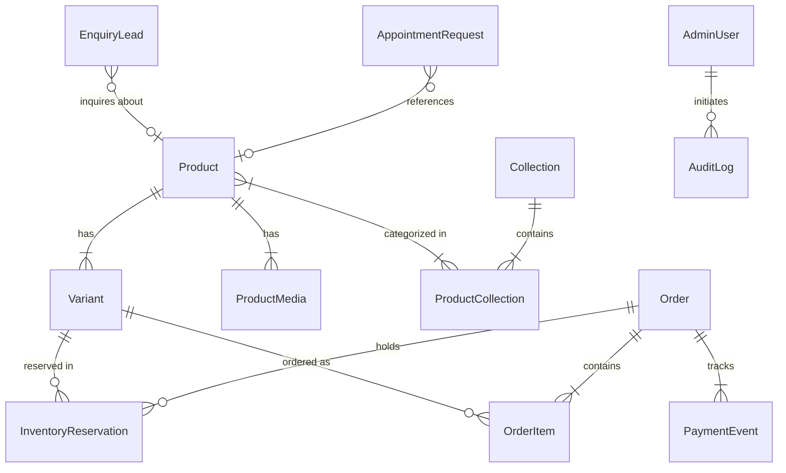
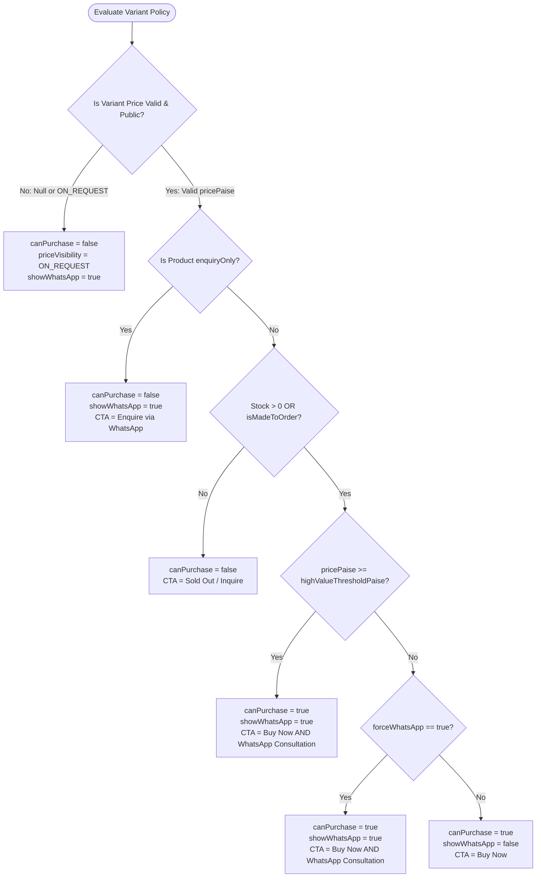
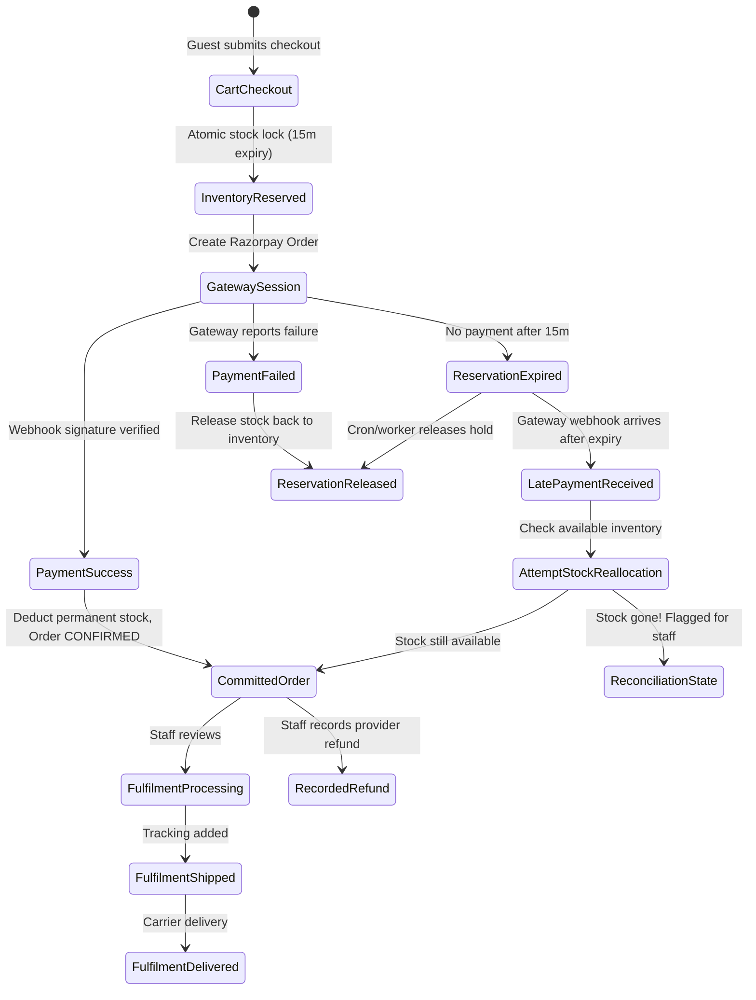

# IMPLEMENTATION_PLAN.md — Technical Architecture & PRD Roadmap

**Document Reference**: Premium Jewellery Website Implementation Plan  
**PRD Companion**: `Jewellery_Website_Client_PRD.docx`  
**Date**: 2026-11-14  
**Target Market**: Domestic Indian Luxury Jewellery Storefront (English / INR)  

---

## 1. PRD Scope & Feature Mapping

| PRD Module ID | Feature / Requirement | Storefront Route / UI Component | Backend Service / API Route | Database Entities | Phase |
| :--- | :--- | :--- | :--- | :--- | :--- |
| **PRD-F01** | Editorial Storefront Homepage | `/` (Hero, Signature Collections, Craftsmanship, Consultation CTA) | `getFeaturedProducts()`, `getCollections()` | `Product`, `Collection`, `Media` | Phase 2 |
| **PRD-F02** | Catalogue & Collection Filtering | `/collections`, `/collections/[slug]` | `getCatalogue(slug, filters, sort, page)` | `Product`, `Variant`, `Collection`, `Category` | Phase 2, 3 |
| **PRD-F03** | Product Detail & Variant Selector | `/products/[slug]` (Gallery, zoom dialog, spec sheet, policy CTA) | `getProductBySlug(slug)` | `Product`, `Variant`, `Media`, `StoreSettings` | Phase 2, 3 |
| **PRD-F04** | Centralized Product Policy Engine | Storefront CTA buttons (`Buy Now`, `Enquire on WhatsApp`) | `/api/policy/evaluate`, `evaluateProductPolicy()` | `Product`, `Variant`, `StoreSettings` | Phase 3 |
| **PRD-F05** | Guest Wishlist | `/wishlist`, Header Wishlist Drawer | LocalStorage client adapter + hydrated DTO validation | `Variant` (validated against public DTO) | Phase 3 |
| **PRD-F06** | WhatsApp Consultation Deep-Link | Contextual WhatsApp CTA button + Modal Fallback | `buildWhatsAppLink(context)` | None (server-generated wa.me URL) | Phase 4 |
| **PRD-F07** | Callback & Appointment Booking | `/consultation`, Inline consultation modal | `/api/enquiries/callback`, `/api/enquiries/appointment` | `EnquiryLead`, `AppointmentRequest` | Phase 4 |
| **PRD-F08** | Admin Portal & RBAC | `/admin/products`, `/admin/orders`, `/admin/leads`, `/admin/settings` | `/api/admin/*`, `adminAuthMiddleware()` | `AdminUser`, `AuditLog`, `StoreSettings` | Phase 4 |
| **PRD-F09** | Catalogue Admin & CSV Import | `/admin/products/import`, `/admin/products/[id]` | `/api/admin/products/import`, `validateCatalogueCsv()` | `Product`, `Variant`, `Media`, `AuditLog` | Phase 4 |
| **PRD-F10** | Persistent Guest Cart | `/cart`, Header Cart Drawer | `validateCartItems(items)` | Local cart synced with server stock/price validator | Phase 5 |
| **PRD-F11** | Guest Checkout & Address Form | `/checkout` | `/api/checkout/initialize` | `Order`, `OrderItem`, `Address` | Phase 5 |
| **PRD-F12** | Atomic Inventory Reservation | Server checkout pipeline | `reserveInventory(variantId, qty, orderId)` | `InventoryItem`, `InventoryReservation` | Phase 5 |
| **PRD-F13** | Hosted Payment Gateway Adapter | Payment modal / Hosted redirect (Razorpay) | `/api/checkout/session`, `/api/webhooks/payment` | `PaymentEvent`, `Order` | Phase 5 |
| **PRD-F14** | Guest Order Confirmation & Tracking | `/order/[token]` (Opaque capability token) | `/api/orders/[token]` | `Order`, `OrderItem`, `PaymentEvent` | Phase 5 |
| **PRD-F15** | Admin Order Fulfilment & Tracking | `/admin/orders/[id]` | `/api/admin/orders/[id]/status` | `Order`, `AuditLog` | Phase 5 |
| **PRD-F16** | SEO, OpenGraph & Product Schema | Server metadata & `<script type="application/ld+json">` | Next.js Metadata API + `generateProductJsonLd()` | `Product`, `Variant` | Phase 6 |
| **PRD-F17** | Performance, A11y & Browser Smoke | Mobile/Desktop viewports, WCAG AA compliance | Test suites, Lighthouse, Playwright runner | All | Phase 6 |
| **PRD-F18** | Production Launch & Runbook | Production deployment, DB backups, rollbacks | CI/CD, migration verification, smoke check | All | Phase 7 |

---

## 2. Proposed Database Schema Specification

All financial amounts are strictly stored as **64-bit integer minor units (`paise`)**.  
1 INR = 100 paise (e.g., ₹1,00,000 = `10000000` paise).



### 2.1 Schema Entities & Fields (Prisma Data Model Outline)

```prisma
enum Role {
  OWNER
  MANAGER
  STAFF
}

enum PriceVisibility {
  PUBLIC
  ON_REQUEST
}

enum OrderStatus {
  PENDING
  CONFIRMED
  CANCELLED
  RECONCILIATION_REQUIRED
}

enum PaymentStatus {
  PENDING
  AUTHORIZED
  PAID
  FAILED
  CANCELLED
  REFUNDED_RECORDED
}

enum FulfilmentStatus {
  UNFULFILLED
  PROCESSING
  SHIPPED
  DELIVERED
  CANCELLED
}

enum ReservationStatus {
  ACTIVE
  COMMITTED
  RELEASED
  EXPIRED
}

enum EnquiryType {
  CALLBACK
  WHATSAPP_INTENT
  APPOINTMENT
}

enum EnquiryStatus {
  NEW
  CONTACTED
  SCHEDULED
  CLOSED_CONVERTED
  CLOSED_LOST
}

model Product {
  id                  String              @id @default(cuid())
  slug                String              @unique
  skuGroup            String              @unique
  title               String
  description         String
  craftsmanshipNotes  String?
  materialSummary     String              // e.g. "18K Yellow Gold with Natural Rose-Cut Diamonds"
  stoneDetails        String?             // e.g. "VS-GH Natural Diamonds, 1.45 ct tw"
  certificationData   String?             // e.g. "BIS Hallmarked & SGL Certified"
  isEnquiryOnly       Boolean             @default(false)
  priceVisibility     PriceVisibility     @default(PUBLIC)
  forceWhatsApp       Boolean             @default(false)
  isArchived          Boolean             @default(false)
  createdAt           DateTime            @default(now())
  updatedAt           DateTime            @updatedAt

  variants            Variant[]
  media               ProductMedia[]
  collections         ProductCollection[]
  leads               EnquiryLead[]
  appointments        AppointmentRequest[]

  @@index([slug])
  @@index([skuGroup])
  @@index([isArchived])
}

model Variant {
  id                  String              @id @default(cuid())
  productId           String
  product             Product             @relation(fields: [productId], references: [id], onDelete: Cascade)
  sku                 String              @unique
  metalType           String              // e.g. "18K Yellow Gold", "Platinum"
  size                String?             // e.g. "Ring Size 14"
  purity              String?             // e.g. "750 / 18K"
  pricePaise          BigInt?             // null when price is ON_REQUEST
  currency            String              @default("INR")
  stockQuantity       Int                 @default(0)
  reservedQuantity    Int                 @default(0) // Virtual counter, validated atomically
  leadTimeDays        Int                 @default(14)
  isMadeToOrder       Boolean             @default(false)
  isPurchaseEnabled   Boolean             @default(true)
  isArchived          Boolean             @default(false)
  createdAt           DateTime            @default(now())
  updatedAt           DateTime            @updatedAt

  reservations        InventoryReservation[]
  orderItems          OrderItem[]

  @@index([productId])
  @@index([sku])
}

model ProductMedia {
  id                  String              @id @default(cuid())
  productId           String
  product             Product             @relation(fields: [productId], references: [id], onDelete: Cascade)
  url                 String
  altText             String
  displayOrder        Int                 @default(0)
  isPrimary           Boolean             @default(false)
  isHoverImage        Boolean             @default(false)
  width               Int?
  height              Int?
  createdAt           DateTime            @default(now())

  @@index([productId, displayOrder])
}

model Collection {
  id                  String              @id @default(cuid())
  slug                String              @unique
  title               String
  description         String?
  bannerImageUrl      String?
  displayOrder        Int                 @default(0)
  isArchived          Boolean             @default(false)
  createdAt           DateTime            @default(now())
  updatedAt           DateTime            @updatedAt

  products            ProductCollection[]

  @@index([slug])
}

model ProductCollection {
  productId           String
  collectionId        String
  product             Product             @relation(fields: [productId], references: [id], onDelete: Cascade)
  collection          Collection          @relation(fields: [collectionId], references: [id], onDelete: Cascade)

  @@id([productId, collectionId])
}

model InventoryReservation {
  id                  String              @id @default(cuid())
  variantId           String
  variant             Variant             @relation(fields: [variantId], references: [id])
  orderId             String?
  order               Order?              @relation(fields: [orderId], references: [id])
  quantity            Int
  status              ReservationStatus   @default(ACTIVE)
  expiresAt           DateTime
  createdAt           DateTime            @default(now())
  updatedAt           DateTime            @updatedAt

  @@index([variantId, status, expiresAt])
}

model Order {
  id                  String              @id @default(cuid())
  orderNumber         String              @unique // Sequential human ID: e.g. "ORD-2026-1001"
  capabilityToken     String              @unique @default(uuid()) // Opaque secure token for guest lookup
  customerName        String
  customerEmail       String
  customerPhone       String
  shippingAddress     Json                // Immutable snapshot of address object
  billingAddress      Json?
  
  currency            String              @default("INR")
  subtotalPaise       BigInt
  taxPaise            BigInt              // GST calculated server-side
  shippingPaise       BigInt              // Insured shipping charge
  totalPaise          BigInt              // subtotal + tax + shipping

  orderStatus         OrderStatus         @default(PENDING)
  paymentStatus       PaymentStatus       @default(PENDING)
  fulfilmentStatus    FulfilmentStatus    @default(UNFULFILLED)

  paymentGateway      String              @default("RAZORPAY")
  gatewayOrderId      String?             @unique
  gatewayPaymentId    String?

  trackingNumber      String?
  carrierName         String?
  adminNotes          String?

  createdAt           DateTime            @default(now())
  updatedAt           DateTime            @updatedAt

  items               OrderItem[]
  reservations        InventoryReservation[]
  paymentEvents       PaymentEvent[]

  @@index([orderNumber])
  @@index([capabilityToken])
  @@index([gatewayOrderId])
}

model OrderItem {
  id                  String              @id @default(cuid())
  orderId             String
  order               Order               @relation(fields: [orderId], references: [id], onDelete: Cascade)
  variantId           String
  variant             Variant             @relation(fields: [variantId], references: [id])
  
  sku                 String
  productTitle        String
  variantAttributes   Json                // Snapshot of size, metal, purity
  unitPricePaise      BigInt              // Immutable snapshot at purchase time
  quantity            Int
  lineTotalPaise      BigInt              // unitPricePaise * quantity

  createdAt           DateTime            @default(now())

  @@index([orderId])
}

model PaymentEvent {
  id                  String              @id @default(cuid())
  orderId             String
  order               Order               @relation(fields: [orderId], references: [id], onDelete: Cascade)
  eventId             String              @unique // Webhook durable event ID
  eventType           String              // e.g. "payment.captured", "payment.failed"
  payload             Json
  signatureVerified   Boolean             @default(false)
  processedAt         DateTime            @default(now())

  @@index([orderId])
  @@index([eventId])
}

model EnquiryLead {
  id                  String              @id @default(cuid())
  type                EnquiryType
  customerName        String
  customerPhone       String
  customerEmail       String?
  preferredTime       String?
  message             String?
  productId           String?
  product             Product?            @relation(fields: [productId], references: [id])
  variantSku          String?
  consentToContact    Boolean             @default(true)
  sourceUrl           String?
  status              EnquiryStatus       @default(NEW)
  staffNotes          String?
  createdAt           DateTime            @default(now())
  updatedAt           DateTime            @updatedAt

  @@index([status])
  @@index([createdAt])
}

model AppointmentRequest {
  id                  String              @id @default(cuid())
  customerName        String
  customerPhone       String
  customerEmail       String
  requestedDate       DateTime
  requestedTimeSlot   String              // e.g. "11:00 AM - 01:00 PM"
  locationPreference  String              // "IN_STORE" | "VIRTUAL"
  productId           String?
  product             Product?            @relation(fields: [productId], references: [id])
  status              EnquiryStatus       @default(NEW)
  staffNotes          String?
  createdAt           DateTime            @default(now())
  updatedAt           DateTime            @updatedAt

  @@index([status])
}

model AdminUser {
  id                  String              @id @default(cuid())
  email               String              @unique
  passwordHash        String
  name                String
  role                Role                @default(STAFF)
  isActive            Boolean             @default(true)
  createdAt           DateTime            @default(now())
  updatedAt           DateTime            @updatedAt

  auditLogs           AuditLog[]
}

model StoreSettings {
  id                      String          @id @default("default")
  storeName               String          @default("Aurum Atelier")
  whatsappNumber          String          @default("919876543210") // International digits only
  highValueThresholdPaise BigInt          @default(10000000) // ₹1,00,000 (10000000 paise)
  gstPercentage           Decimal         @default(3.0) // 3% GST on precious jewellery
  enablePurchases         Boolean         @default(true)
  contactEmail            String          @default("concierge@aurum.internal")
  updatedAt               DateTime        @updatedAt
}

model AuditLog {
  id                  String              @id @default(cuid())
  userId              String?
  user                AdminUser?          @relation(fields: [userId], references: [id])
  action              String              // "PRICE_UPDATE", "STOCK_ADJUST", "STATUS_CHANGE"
  entityType          String              // "Product", "Variant", "Order", "Settings"
  entityId            String
  details             Json
  ipAddress           String?
  createdAt           DateTime            @default(now())

  @@index([entityType, entityId])
  @@index([createdAt])
}
```

---

## 3. Policy Engine Specification (`evaluateProductPolicy`)

The policy engine is the single source of truth for both storefront display logic and backend order admission.



### Policy Rules
1. **Threshold Rule**: `pricePaise >= highValueThresholdPaise` (Equality is explicitly inclusive).
2. **Consultation Priority**: High price alone **never** disables purchase if stock is available and product is not marked `enquiryOnly`.
3. **Hidden Prices**: If `priceVisibility == ON_REQUEST` or `pricePaise == null`:
   - `pricePaise` is redacted from public DTOs, HTML, JSON-LD, and URL parameters.
   - Price display renders `"Price upon request"`.
   - Purchase is strictly prohibited on server validation.
4. **Enquiry-Only Override**: If `isEnquiryOnly == true`, checkout is unconditionally blocked.
5. **WhatsApp Deep-Link Format**:
   - `https://wa.me/{digitsOnlyNumber}?text={encodedText}`
   - Format:
     ```text
     Hello, I would like to inquire about:
     Product: {productTitle}
     SKU: {variantSku}
     Variant: {variantDescription}
     Price: {formattedPublicPrice || "Upon Request"}
     URL: {canonicalProductUrl}
     ```
   - Must never contain internal cost, margin, notes, or customer PII.

---

## 4. Payment & Inventory State Machine



### Invariants:
1. **Atomic Stock Locking**:
   - Reservations use PostgreSQL `SELECT ... FOR UPDATE` or conditional SQL:
     ```sql
     UPDATE "Variant" 
     SET "stockQuantity" = "stockQuantity" - $qty, "reservedQuantity" = "reservedQuantity" + $qty 
     WHERE "id" = $variantId AND "stockQuantity" >= $qty;
     ```
2. **Late Payment Handling**:
   - If payment arrives after reservation expiry, the webhook processor attempts safe allocation.
   - If stock is exhausted, order transitions to `RECONCILIATION_REQUIRED` and alerts staff. Customer money is never discarded or ignored.
3. **Webhook Verification**:
   - Razorpay HMAC SHA256 signature verification over raw incoming request body.
   - Durable `PaymentEvent` table ensures idempotency.

---

## 5. Security & Privacy Model

1. **Guest Order Access**:
   - Sequential order numbers (`ORD-2026-1001`) are only visible on internal views or client receipts.
   - Storefront order status route is governed by `capabilityToken` (`/order/[token]`), a cryptographically secure UUIDv4.
   - Guessing an order ID yields zero access to order details or customer address.
2. **Admin Authentication & RBAC**:
   - Session authentication using HTTP-only, `SameSite=Strict`, `Secure` cookies.
   - Cryptographic password hashing with `argon2` or `bcrypt` (work factor 12).
   - Server-side RBAC:
     - `STAFF`: View orders, update fulfilment status, view/manage enquiries.
     - `MANAGER`: Edit products, upload media, manage catalogue.
     - `OWNER`: Store settings, high-value threshold, tax/shipping policies, user management.
3. **Data Protection & Sanitization**:
   - Zod validation for all API inputs.
   - Anti-spam rate limiting on `/api/enquiries/*` (e.g. 5 requests per IP per 10 minutes).
   - Strict Content Security Policy (CSP) and sanitization of user-submitted notes.
   - Customer phone numbers and emails redacted in application logs.

---

## 6. Test Approach & Verification Strategy

### 6.1 Tooling
- **Unit / Logic Tests**: Vitest for fast, deterministic unit checks (money arithmetic, policy evaluation, WhatsApp link builder, CSV validator).
- **Integration Tests**: Vitest with isolated, disposable PostgreSQL database for concurrency, transactions, reservations, and webhook replays.
- **E2E / Browser Smoke Matrix**: Playwright for desktop and mobile viewport tests (S01–S30).

### 6.2 Test Database Isolation
- Test runners run against a dedicated disposable PostgreSQL database schema (`test_schema`), migrated fresh before test execution.
- Deterministic seeding with boundary values:
  - Below threshold: `9,999,900` paise (₹99,999.00)
  - Equal threshold: `10,000,000` paise (₹1,00,000.00)
  - Above threshold: `10,000,100` paise (₹1,00,001.00)
  - `ON_REQUEST` fixture: `pricePaise = null`
  - `enquiryOnly` fixture: `isEnquiryOnly = true`
  - Out-of-stock and made-to-order fixtures.

---

## 7. Phase Delivery Mapping

- **Phase 0**: Discovery, audit, and implementation contracts (Current).
- **Phase 1**: Application foundation, Next.js + TypeScript + Tailwind, Prisma schema, boundary fixtures, safe public DTOs, health checks.
- **Phase 2**: Design system tokens (Warm Ivory, Charcoal, Antique Gold), responsive layouts, navigation, PDP gallery, modal zoom, design artifacts review.
- **Phase 3**: Real database catalogue, collection filtering with URL persistence, centralized policy engine, guest wishlist.
- **Phase 4**: WhatsApp consultation deep-links, callback/appointment leads, anti-spam, secure admin portal with RBAC.
- **Phase 5**: Guest cart, atomic inventory reservations, hosted payment adapter (Razorpay sandbox), durable webhook processing, guest capability order tracking.
- **Phase 6**: SEO/Schema.org, analytics without PII, image optimization, full smoke matrix execution (S01–S30).
- **Phase 7**: Production readiness, client UAT, backup/restore rehearsal, deployment runbook.
