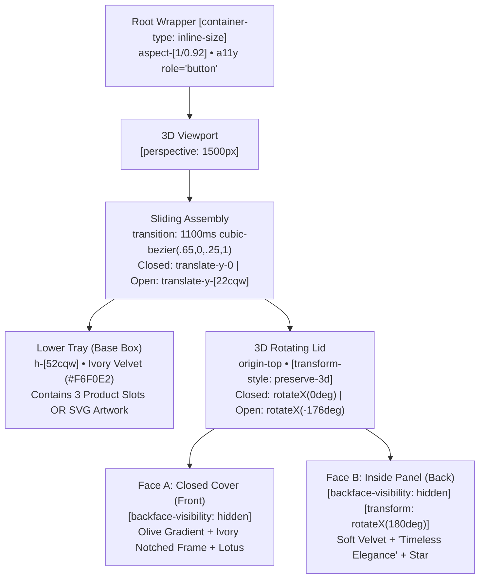

# 💎 3D Hover-to-Open Jewellery Gift Box — Complete Feature Guide & Source Code

This document provides a comprehensive technical breakdown and complete source code for the **Interactive 3D Hover-to-Open Jewellery Gift Box** feature implemented in the Chudiwalas Next.js application.

---

## 📑 Table of Contents
1. [Executive Summary & Concept](#1-executive-summary--concept)
2. [Component Architecture & 3D Mechanics](#2-component-architecture--3d-mechanics)
3. [Animation & Timing Sequence](#3-animation--timing-sequence)
4. [Responsive Sizing via Container Queries (cqw)](#4-responsive-sizing-via-container-queries-cqw)
5. [Cross-Platform & Accessibility (A11y)](#5-cross-platform--accessibility-a11y)
6. [Complete Source Code](#6-complete-source-code)
   - [JewelleryBox.tsx](#a-jewelleryboxtsx-core-client-component)
   - [JewelleryIllustration.tsx](#b-jewelleryillustrationtsx-procedural-svg-artwork)
   - [LotusMotif.tsx](#c-lotusmotiftsx-vector-blossom-artwork)
7. [How to Use & Examples](#7-how-to-use--examples)

---

## 1. Executive Summary & Concept

The **JewelleryBox** component simulates an ultra-luxury physical jewellery presentation box in brand olive green (`#556B2F`) with ivory (`#F6F0E2`) and burnt orange (`#CC5500`) accents. 

- **Closed State**: The card looks like a closed luxury gift box featuring a concave notched-corner frame, gilded typography ("NO. 01", circled monogram, title, subtitle), and a botanical lotus flower emblem.
- **Open State**: On hover (desktop) or tap (mobile/keyboard), the lid hinges on its top edge and rotates backwards in true 3D space (`rotateX(-176deg)`). As the lid flips back, the inner box assembly slides downward smoothly so the entire open presentation remains perfectly centered in the viewer's eye. Inside, an ivory velvet tray is revealed where product pieces fade in with a luxurious staggered timing sequence.
- **Zero Heavy Animation Libraries**: Operates on pure CSS 3D transforms, CSS transitions, and Tailwind CSS utility classes — zero Framer Motion or GSAP dependencies.

---

## 2. Component Architecture & 3D Mechanics



### The 3D Flip Hinge Mechanism
1. **The Lid is Dual-Faced**:
   - **Face A (Outer Lid)**: Visible when closed. Has `[backface-visibility: hidden]`.
   - **Face B (Inner Lid Panel)**: Pre-rotated with `[transform: rotateX(180deg)]` and `[backface-visibility: hidden]`. When closed, it faces away from the user and is invisible.
2. **Top Hinge Rotation**:
   - The lid container has `origin-top` (the hinge is at the top border).
   - When opened, the lid container rotates `rotateX(-176deg)`.
   - Because Face B was pre-rotated by 180°, flipping `-176°` brings Face B facing front and right-side up, perfectly legible to the viewer!
3. **The Sliding Counterbalance Assembly**:
   - Because the lid flips upward and backward by ~48cqw, if the box stayed static, the top of the lid would jump way up outside the card boundary.
   - To counteract this, the entire box assembly (`Lower Tray + Lid`) slides downward by `translate-y-[22cqw]`.
   - Result: The opened box stays optical center with zero layout jumping.

---

## 3. Animation & Timing Sequence

| Time | Event | Description |
| :--- | :--- | :--- |
| **0.00s** | **Trigger** | User hovers mouse or presses Enter/tap. `data-open="true"` is set. |
| **0.00s – 1.10s** | **Lid Flip & Box Slide** | Lid rotates `rotateX(-176deg)` and assembly translates `+22cqw` using custom easing `cubic-bezier(.65,0,.25,1)`. |
| **0.60s** | **Item 1 Enters** | Left item fades in (`opacity: 1`) and floats up (`translateY: 0`). |
| **0.78s** | **Item 2 Enters (Hero)** | Center hero item fades in (+180ms delay). |
| **0.96s** | **Item 3 Enters** | Right item fades in (+180ms delay). |
| **Mouse Leave** | **Rapid Reverse Close** | Items fade out immediately (150ms, `delay-0`), and the lid snaps shut smoothly over 1100ms. |

---

## 4. Responsive Sizing via Container Queries (`cqw`)

Instead of standard media queries (`@media (min-width: 768px)`), every element inside the box is sized using **Container Query Units** (`cqw`):
- `1cqw = 1% of the box's own width`.
- Box height: `h-[52cqw]` (always exactly 52% of its width).
- Text title: `text-[clamp(17px,7.8cqw,36px)]` (scales smoothly from 300px mobile to 600px desktop).
- Notched border: SVG path with `vectorEffect="non-scaling-stroke"`.
- Container aspect ratio: `aspect-[1/0.92] sm:aspect-[1/0.95]` reserves the vertical envelope so layout never shifts (CLS = 0) and eliminates empty viewport blowout gaps.

---

## 5. Cross-Platform & Accessibility (A11y)

1. **Mouse / Desktop**:
   - Listens to `onPointerEnter` and `onPointerLeave`.
   - Strictly validates `e.pointerType === "mouse"` so touch interactions on smartphones never trigger accidental mouse hover loops.
2. **Mobile / Touch**:
   - Tapping the box toggles `isOpen` state between open and closed.
3. **Keyboard Users**:
   - `role="button"` and `tabIndex={0}`.
   - Screen reader announcement: `aria-label="Jewellery box. Hover, tap or press Enter to open."`
   - `aria-expanded={isOpen}` dynamically updates.
   - Pressing <kbd>Enter</kbd> or <kbd>Space</kbd> toggles the box.
   - Pressing <kbd>Escape</kbd> immediately closes the box.
4. **Reduced Motion**:
   - Detects `prefers-reduced-motion: reduce`.
   - Automatically disables all 3D rotations and sliding transforms, replacing them with a gentle 150ms opacity cross-fade.

---

## 6. Complete Source Code

### A. `JewelleryBox.tsx` (Core Client Component)
Path: `src/components/jewellery-box/JewelleryBox.tsx`

```tsx
"use client";

import React, { useState, useRef, useCallback } from "react";
import Image from "next/image";
import Link from "next/link";
import { cn } from "@/lib/utils";
import { LotusMotif } from "./LotusMotif";
import { JewelleryIllustration } from "./JewelleryIllustration";

export interface JewelleryBoxItem {
  src: string;
  alt: string;
  href?: string;
}

export interface JewelleryBoxProps {
  title?: string;
  number?: string;
  monogram?: string;
  subtitle?: string;
  tagline?: string;
  images?: JewelleryBoxItem[];
  className?: string;
}

export const JewelleryBox: React.FC<JewelleryBoxProps> = ({
  title = "Jewellery",
  number = "NO. 01",
  monogram = "R",
  subtitle = "Premium Collection, 2026",
  tagline = "Timeless Elegance",
  images = [],
  className,
}) => {
  const [isOpen, setIsOpen] = useState(false);
  const [isTransitioning, setIsTransitioning] = useState(false);
  const transitionTimerRef = useRef<NodeJS.Timeout | null>(null);

  const handleStateChange = useCallback((open: boolean) => {
    setIsOpen(open);
    setIsTransitioning(true);
    if (transitionTimerRef.current) clearTimeout(transitionTimerRef.current);
    transitionTimerRef.current = setTimeout(() => {
      setIsTransitioning(false);
    }, 1150);
  }, []);

  const handleKeyDown = (e: React.KeyboardEvent) => {
    if (e.key === "Enter" || e.key === " ") {
      e.preventDefault();
      handleStateChange(!isOpen);
    } else if (e.key === "Escape" && isOpen) {
      e.preventDefault();
      handleStateChange(false);
    }
  };

  const hasImages = images && images.length > 0;

  return (
    <div
      role="button"
      tabIndex={0}
      aria-expanded={isOpen}
      aria-label="Jewellery box. Hover, tap or press Enter to open."
      data-open={isOpen}
      onPointerEnter={(e) => {
        if (e.pointerType === "mouse") handleStateChange(true);
      }}
      onPointerLeave={(e) => {
        if (e.pointerType === "mouse") handleStateChange(false);
      }}
      onClick={() => {
        handleStateChange(!isOpen);
      }}
      onKeyDown={handleKeyDown}
      className={cn(
        "group/box relative w-full [container-type:inline-size] select-none cursor-pointer outline-none",
        "aspect-[1/0.92] sm:aspect-[1/0.95]",
        "focus-visible:ring-2 focus-visible:ring-[#556B2F] focus-visible:ring-offset-4 ring-offset-white rounded-2xl",
        className
      )}
    >
      <div className="relative w-full h-full flex items-center justify-center [perspective:1500px]">
        {/* SLIDING BOX ASSEMBLY */}
        <div
          className={cn(
            "relative w-full max-w-[100cqw] transition-transform duration-[1100ms] ease-[cubic-bezier(.65,0,.25,1)]",
            "motion-reduce:transition-none motion-reduce:transform-none",
            isOpen ? "translate-y-[22cqw]" : "translate-y-[0cqw]"
          )}
        >
          {/* 1. LOWER TRAY / BASE BOX */}
          <div
            className={cn(
              "relative w-full h-[52cqw] rounded-[1.6cqw] overflow-hidden shadow-[0_24px_60px_rgba(26, 26, 26,0.30)]",
              "bg-gradient-to-b from-[#556B2F] via-[#65205B] to-[#481340]",
              "border border-[#54194A]"
            )}
          >
            {/* Front Lip Accent Stripe */}
            <div className="absolute bottom-0 inset-x-0 h-[4.5cqw] bg-gradient-to-t from-[#360D2D] to-[#5C1A50] border-t border-[#8B357F]/60 flex items-center px-[3cqw] z-20">
              <div className="w-full h-[0.35cqw] bg-[#E9E2CC]/85 rounded-full shadow-[0_1px_2px_rgba(0,0,0,0.2)]" />
            </div>

            {/* Recessed Ivory Velvet Interior */}
            <div className="absolute inset-[1.8cqw] bottom-[4.8cqw] rounded-[1.2cqw] bg-gradient-to-b from-[#F2DDD9] via-[#FAF0EE] to-[#F5E2DE] border border-[#E9E2CC] shadow-[inset_0_4px_16px_rgba(26, 26, 26,0.18)] p-[2.2cqw] overflow-hidden flex items-center justify-center">
              {hasImages ? (
                <div className="relative z-10 w-full h-full flex items-center justify-center gap-[2.5cqw]">
                  {images.slice(0, 3).map((item, idx) => {
                    const is3Items = images.length === 3;
                    const isHero = is3Items && idx === 1;

                    const slotHeight = is3Items
                      ? isHero ? "h-[94%]" : "h-[72%]"
                      : images.length === 2 ? "h-[85%]" : "h-[92%]";

                    const slotFlex = is3Items
                      ? isHero ? "flex-[1.45]" : "flex-1"
                      : "flex-1";

                    const delayClass = isOpen
                      ? idx === 0 ? "delay-[600ms]" : idx === 1 ? "delay-[780ms]" : "delay-[960ms]"
                      : "delay-0";

                    const cardNode = (
                      <div
                        className={cn(
                          "relative w-full h-full rounded-[1.2cqw] overflow-hidden p-[1cqw]",
                          "bg-white/55 backdrop-blur-[2px] border border-[#E9E2CC]/80",
                          "shadow-[0_6px_18px_rgba(85, 107, 47,0.14)]",
                          "transition-transform duration-300 hover:scale-[1.03]"
                        )}
                      >
                        <div className="relative w-full h-full rounded-[0.8cqw] overflow-hidden bg-stone-100">
                          <Image
                            src={item.src}
                            alt={item.alt}
                            fill
                            sizes="(max-width: 640px) 30vw, 22vw"
                            className="object-cover object-center"
                            loading="lazy"
                          />
                        </div>
                      </div>
                    );

                    return (
                      <div
                        key={idx}
                        className={cn(
                          slotFlex,
                          slotHeight,
                          "self-center transition-all ease-[cubic-bezier(0.16,1,0.3,1)]",
                          isOpen ? "duration-500" : "duration-150",
                          delayClass,
                          "motion-reduce:transition-opacity motion-reduce:delay-0 motion-reduce:duration-150",
                          isOpen
                            ? "opacity-100 translate-y-0 pointer-events-auto"
                            : "opacity-0 translate-y-[2.5cqw] pointer-events-none"
                        )}
                      >
                        {item.href && isOpen ? (
                          <Link
                            href={item.href}
                            className="block w-full h-full outline-none focus-visible:ring-2 focus-visible:ring-[#556B2F] rounded-[1.2cqw]"
                            onClick={(e) => e.stopPropagation()}
                            tabIndex={isOpen ? 0 : -1}
                          >
                            {cardNode}
                          </Link>
                        ) : (
                          cardNode
                        )}
                      </div>
                    );
                  })}
                </div>
              ) : (
                <div
                  className={cn(
                    "relative z-10 w-full h-full flex items-center justify-center transition-all ease-[cubic-bezier(0.16,1,0.3,1)]",
                    isOpen ? "duration-700 delay-[600ms]" : "duration-150 delay-0",
                    "motion-reduce:transition-opacity motion-reduce:delay-0 motion-reduce:duration-150",
                    isOpen ? "opacity-100 translate-y-0" : "opacity-0 translate-y-[2cqw]"
                  )}
                >
                  <JewelleryIllustration className="w-full h-full max-h-[42cqw]" />
                </div>
              )}
            </div>
          </div>

          {/* 2. THE 3D ROTATING LID */}
          <div
            className={cn(
              "absolute top-0 left-0 w-full h-[52cqw] origin-top [transform-style:preserve-3d]",
              "transition-transform duration-[1100ms] ease-[cubic-bezier(.65,0,.25,1)]",
              isTransitioning && "will-change-transform",
              "motion-reduce:transition-opacity motion-reduce:duration-150 motion-reduce:transform-none",
              isOpen
                ? "[transform:rotateX(-176deg)] motion-reduce:opacity-0 motion-reduce:pointer-events-none"
                : "[transform:rotateX(0deg)] motion-reduce:opacity-100"
            )}
          >
            {/* FACE A: CLOSED LID EXTERIOR */}
            <div
              className={cn(
                "absolute inset-0 w-full h-full [backface-visibility:hidden] rounded-[1.6cqw] overflow-hidden",
                "bg-gradient-to-br from-[#843279] via-[#556B2F] to-[#591C4F]",
                "border border-[#943F89] shadow-[0_16px_40px_rgba(26, 26, 26,0.35)]"
              )}
            >
              {/* Bottom Lip Accent */}
              <div className="absolute bottom-0 inset-x-0 h-[4.2cqw] bg-gradient-to-t from-[#401237] to-[#6A235F] border-t border-[#8D3782]/70 flex items-center px-[3cqw] z-10">
                <div className="w-full h-[0.35cqw] bg-[#E9E2CC]/85 rounded-full" />
              </div>

              {/* Concave Notched Inner Rose Frame */}
              <svg
                className="absolute inset-[2.4cqw] bottom-[5.8cqw] w-[calc(100%-4.8cqw)] h-[calc(100%-8.2cqw)] pointer-events-none"
                viewBox="0 0 100 100"
                preserveAspectRatio="none"
                aria-hidden="true"
              >
                <path
                  d="M 6 0 L 94 0 A 6 6 0 0 0 100 6 L 100 94 A 6 6 0 0 0 94 100 L 6 100 A 6 6 0 0 0 0 94 L 0 6 A 6 6 0 0 0 6 0 Z"
                  fill="none"
                  stroke="#E9E2CC"
                  strokeWidth="0.8"
                  vectorEffect="non-scaling-stroke"
                />
              </svg>

              {/* Meta: Number & Monogram */}
              <div className="absolute top-[4.6cqw] inset-x-[5.2cqw] flex items-center justify-between">
                <span className="font-mono text-[max(9px,2.3cqw)] tracking-[0.25em] text-[#E9E2CC] uppercase font-medium">
                  {number}
                </span>

                <div className="w-[6.2cqw] h-[6.2cqw] min-w-[24px] min-h-[24px] rounded-full border border-[#E9E2CC] text-[#E9E2CC] flex items-center justify-center font-serif text-[max(11px,2.9cqw)] font-medium">
                  {monogram}
                </div>
              </div>

              {/* Title & Subtitle */}
              <div className="absolute top-[15cqw] left-[5.2cqw] pr-[18cqw]">
                <h2 className="font-serif text-[clamp(17px,7.8cqw,36px)] font-semibold text-white tracking-tight leading-none drop-shadow-sm">
                  {title}
                </h2>
                <div className="w-[12cqw] h-[0.38cqw] min-h-[2px] bg-[#E9E2CC] rounded-full mt-[1.8cqw]" />
                <p className="text-[max(9px,2.4cqw)] text-[#E9E2CC]/90 tracking-wide font-light mt-[1.6cqw]">
                  {subtitle}
                </p>
              </div>

              {/* Lotus Blossom Artwork */}
              <div className="absolute bottom-[7cqw] right-[4.8cqw] w-[18cqw] h-[15cqw] pointer-events-none">
                <LotusMotif className="w-full h-full text-[#E9E2CC] opacity-90 drop-shadow-sm" />
              </div>
            </div>

            {/* FACE B: INSIDE LID PANEL */}
            <div
              className={cn(
                "absolute inset-0 w-full h-full rounded-[1.6cqw] overflow-hidden",
                "[backface-visibility:hidden] [transform:rotateX(180deg)]",
                "bg-[#68215D] border border-[#521749] shadow-[0_-12px_36px_rgba(26, 26, 26,0.30)]",
                "p-[1.8cqw]"
              )}
            >
              <div className="relative w-full h-full rounded-[1.2cqw] bg-gradient-to-b from-[#FAF0EE] via-[#FDF5F3] to-[#F5E2DE] border border-[#E9E2CC] shadow-[inset_0_4px_16px_rgba(26, 26, 26,0.12)] flex flex-col items-center justify-center text-center p-[4cqw]">
                <div className="relative z-10 flex items-center justify-center gap-[2.5cqw] w-full max-w-[80%]">
                  <div className="flex-1 h-[1px] bg-[#556B2F]/35" />
                  <span className="font-serif text-[clamp(10px,2.8cqw,13px)] tracking-[0.2em] font-medium uppercase text-[#556B2F] whitespace-nowrap">
                    {tagline}
                  </span>
                  <div className="flex-1 h-[1px] bg-[#556B2F]/35" />
                </div>
                <div className="relative z-10 mt-[2cqw] text-[#556B2F] text-[max(10px,2.6cqw)] select-none">
                  ✦
                </div>
              </div>
            </div>
          </div>
        </div>
      </div>
    </div>
  );
};

export default JewelleryBox;
```

---

### B. `JewelleryIllustration.tsx` (Procedural SVG Artwork)
Path: `src/components/jewellery-box/JewelleryIllustration.tsx`

```tsx
import React, { useMemo } from "react";

export interface JewelleryIllustrationProps extends React.SVGProps<SVGSVGElement> {
  className?: string;
}

interface CollarGem {
  x: number;
  y: number;
  r: number;
  isRuby: boolean;
}

interface DropSpur {
  x1: number;
  y1: number;
  x2: number;
  y2: number;
  rubyX: number;
  rubyY: number;
  rubyR: number;
}

function buildNecklaceGeometry(): { gems: CollarGem[]; drops: DropSpur[] } {
  const gems: CollarGem[] = [];
  const drops: DropSpur[] = [];
  const totalGems = 27;

  for (let i = 0; i < totalGems; i++) {
    const t = i / (totalGems - 1);
    const angle = Math.PI * (0.16 + 0.68 * t);
    const rx = 35;
    const ry = 26;
    const x = 200 - rx * Math.cos(angle);
    const y = 45 + ry * Math.sin(angle);

    const distFromCenter = Math.abs(t - 0.5);
    const r = 2.2 - distFromCenter * 0.9;
    gems.push({
      x: Number(x.toFixed(2)),
      y: Number(y.toFixed(2)),
      r: Number(r.toFixed(2)),
      isRuby: i % 5 === 2,
    });

    if (i >= 8 && i <= 18 && i % 2 === 0 && i !== 13) {
      const dropLen = 5 - Math.abs(i - 13) * 0.6;
      drops.push({
        x1: Number(x.toFixed(2)),
        y1: Number(y.toFixed(2)),
        x2: Number(x.toFixed(2)),
        y2: Number((y + dropLen).toFixed(2)),
        rubyX: Number(x.toFixed(2)),
        rubyY: Number((y + dropLen + 1.2).toFixed(2)),
        rubyR: 1.4,
      });
    }
  }

  return { gems, drops };
}

export const JewelleryIllustration: React.FC<JewelleryIllustrationProps> = ({
  className = "w-full h-full",
  ...props
}) => {
  const { gems, drops } = useMemo(() => buildNecklaceGeometry(), []);

  return (
    <svg
      viewBox="0 0 400 160"
      fill="none"
      xmlns="http://www.w3.org/2000/svg"
      className={className}
      preserveAspectRatio="xMidYMid meet"
      aria-label="Artisanal ruby and diamond polki necklace, chandelier earrings, and cocktail ring on velvet display stands"
      role="img"
      {...props}
    >
      <defs>
        <radialGradient id="rubyGlow" cx="40%" cy="40%" r="60%">
          <stop offset="0%" stopColor="#E23E6B" />
          <stop offset="60%" stopColor="#A8163E" />
          <stop offset="100%" stopColor="#670520" />
        </radialGradient>
        <radialGradient id="diamondSparkle" cx="35%" cy="35%" r="65%">
          <stop offset="0%" stopColor="#F6F0E2" />
          <stop offset="50%" stopColor="#F5F2F7" />
          <stop offset="100%" stopColor="#D5CFDC" />
        </radialGradient>
        <linearGradient id="goldCollar" x1="0%" y1="0%" x2="100%" y2="100%">
          <stop offset="0%" stopColor="#FDEBC8" />
          <stop offset="50%" stopColor="#CC5500" />
          <stop offset="100%" stopColor="#B38646" />
        </linearGradient>
        <linearGradient id="velvetStand" x1="0%" y1="0%" x2="0%" y2="100%">
          <stop offset="0%" stopColor="#FDF7F5" />
          <stop offset="60%" stopColor="#F3E2DF" />
          <stop offset="100%" stopColor="#E5CCC8" />
        </linearGradient>
        <filter id="softDropShadow" x="-10%" y="-10%" width="120%" height="120%">
          <feDropShadow dx="0" dy="3" stdDeviation="3" floodColor="#401237" floodOpacity="0.15" />
        </filter>
      </defs>

      {/* 1. LEFT EARRING DISPLAY STAND */}
      <g id="earring-stand-left" filter="url(#softDropShadow)">
        <rect x="52" y="112" width="44" height="14" rx="2.5" fill="url(#velvetStand)" stroke="#E8D2CE" strokeWidth="0.8" />
        <line x1="74" y1="112" x2="74" y2="70" stroke="url(#goldCollar)" strokeWidth="1.8" strokeLinecap="round" />
        <line x1="57" y1="70" x2="91" y2="70" stroke="url(#goldCollar)" strokeWidth="1.8" strokeLinecap="round" />
        <circle cx="64" cy="74" r="2.2" fill="url(#diamondSparkle)" stroke="#C8A061" strokeWidth="0.5" />
        <circle cx="64" cy="74" r="1.3" fill="url(#rubyGlow)" />
        <path d="M 64 78 Q 60 84 64 88 Q 68 84 64 78 Z" fill="url(#rubyGlow)" stroke="#F8C488" strokeWidth="0.6" />
        <circle cx="84" cy="74" r="2.2" fill="url(#diamondSparkle)" stroke="#C8A061" strokeWidth="0.5" />
        <circle cx="84" cy="74" r="1.3" fill="url(#rubyGlow)" />
        <path d="M 84 78 Q 80 84 84 88 Q 88 84 84 78 Z" fill="url(#rubyGlow)" stroke="#F8C488" strokeWidth="0.6" />
      </g>

      {/* 2. CENTER DISPLAY BUST WITH POLKI NECKLACE */}
      <g id="necklace-bust-center" filter="url(#softDropShadow)">
        <path d="M 172 32 C 182 32, 186 36, 200 36 C 214 36, 218 32, 228 32 C 242 44, 258 72, 260 126 L 140 126 C 142 72, 158 44, 172 32 Z" fill="url(#velvetStand)" stroke="#E8D2CE" strokeWidth="1" />
        <path d="M 166 48 Q 200 84 234 48" fill="none" stroke="url(#goldCollar)" strokeWidth="1.6" strokeLinecap="round" />
        {gems.map((gem, idx) => (
          <circle key={idx} cx={gem.x} cy={gem.y} r={gem.r} fill={gem.isRuby ? "url(#rubyGlow)" : "url(#diamondSparkle)"} stroke="#D6A463" strokeWidth="0.5" />
        ))}
        {drops.map((drop, idx) => (
          <g key={idx}>
            <line x1={drop.x1} y1={drop.y1} x2={drop.x2} y2={drop.y2} stroke="url(#goldCollar)" strokeWidth="0.8" />
            <circle cx={drop.rubyX} cy={drop.rubyY} r={drop.rubyR} fill="url(#rubyGlow)" stroke="#F5C284" strokeWidth="0.4" />
          </g>
        ))}
        {/* Central Teardrop Ruby Halo Pendant */}
        <line x1="200" y1="71" x2="200" y2="76" stroke="url(#goldCollar)" strokeWidth="1.2" />
        <path d="M 200 76 Q 194 85 200 92 Q 206 85 200 76 Z" fill="url(#rubyGlow)" stroke="#E8BA7B" strokeWidth="1" />
        <circle cx="200" cy="94" r="1.4" fill="url(#diamondSparkle)" stroke="#C8A061" strokeWidth="0.4" />
      </g>

      {/* 3. RIGHT COCKTAIL RING PEDESTAL */}
      <g id="ring-pedestal-right" filter="url(#softDropShadow)">
        <rect x="306" y="98" width="40" height="28" rx="2.5" fill="url(#velvetStand)" stroke="#E8D2CE" strokeWidth="0.8" />
        <path d="M 314 98 Q 326 102 338 98" fill="none" stroke="#D8BCB7" strokeWidth="1" />
        <ellipse cx="326" cy="92" rx="7" ry="4.5" fill="none" stroke="url(#goldCollar)" strokeWidth="1.6" />
        <circle cx="326" cy="88" r="3.2" fill="url(#rubyGlow)" stroke="#F5C284" strokeWidth="0.6" />
        {[0, 60, 120, 180, 240, 300].map((angle, i) => {
          const rad = (angle * Math.PI) / 180;
          return <circle key={i} cx={326 + 4.8 * Math.cos(rad)} cy={88 + 4.8 * Math.sin(rad)} r="1" fill="url(#diamondSparkle)" stroke="#C8A061" strokeWidth="0.3" />;
        })}
      </g>
    </svg>
  );
};
```

---

### C. `LotusMotif.tsx` (Vector Blossom Artwork)
Path: `src/components/jewellery-box/LotusMotif.tsx`

```tsx
import React from "react";

export interface LotusMotifProps extends React.SVGProps<SVGSVGElement> {
  className?: string;
}

export const LotusMotif: React.FC<LotusMotifProps> = ({
  className = "w-full h-full",
  ...props
}) => {
  return (
    <svg
      viewBox="0 0 100 80"
      fill="none"
      xmlns="http://www.w3.org/2000/svg"
      className={className}
      preserveAspectRatio="xMidYMid meet"
      aria-hidden="true"
      {...props}
    >
      {/* Outer Left Outspread Petal */}
      <path
        d="M 50 72 C 34 68 18 52 14 36 C 24 38 38 48 50 72 Z"
        fill="currentColor"
        opacity="0.75"
      />
      {/* Inner Left Petal */}
      <path
        d="M 50 72 C 38 60 26 38 28 22 C 38 28 46 44 50 72 Z"
        fill="currentColor"
        opacity="0.88"
      />
      {/* Upright Center Petal */}
      <path
        d="M 50 72 C 43 46 40 18 50 8 C 60 18 57 46 50 72 Z"
        fill="currentColor"
        opacity="0.96"
      />
      {/* Inner Right Petal */}
      <path
        d="M 50 72 C 62 60 74 38 72 22 C 62 28 54 44 50 72 Z"
        fill="currentColor"
        opacity="0.88"
      />
      {/* Outer Right Outspread Petal */}
      <path
        d="M 50 72 C 66 68 82 52 86 36 C 76 38 62 48 50 72 Z"
        fill="currentColor"
        opacity="0.75"
      />
    </svg>
  );
};
```

---

## 7. How to Use & Examples

### Example 1: With Built-in Procedural SVG Artwork (Default)
Passing an empty array or omitting `images` renders the built-in SVG bust, necklace, earrings, and ring display:

```tsx
import { JewelleryBox } from "@/components/jewellery-box/JewelleryBox";

export function AtelierHighlight() {
  return (
    <div className="max-w-md mx-auto">
      <JewelleryBox
        number="NO. 01"
        title="Jewellery"
        monogram="R"
        subtitle="Premium Collection, 2026"
        tagline="Timeless Elegance"
        images={[]} // Triggers procedural SVG illustration
      />
    </div>
  );
}
```

### Example 2: With 3 Real Products (Middle Item is Automatic Hero)
```tsx
import { JewelleryBox } from "@/components/jewellery-box/JewelleryBox";

export function BridalSuiteBox() {
  return (
    <div className="max-w-md mx-auto">
      <JewelleryBox
        number="NO. 03"
        title="Bridal"
        monogram="B"
        subtitle="Imperial Wedding, 2026"
        tagline="Sacred Splendor"
        images={[
          {
            src: "https://images.unsplash.com/photo-1611591475152-477d130a08e0?q=80&w=800",
            alt: "22K bridal jhumka earrings",
            href: "/collections/bridal-connoisseur",
          },
          {
            src: "https://images.unsplash.com/photo-1515562141207-7a88fb7ce338?q=80&w=800",
            alt: "Grand bridal polki necklace suite",
            href: "/collections/bridal-connoisseur",
          },
          {
            src: "https://images.unsplash.com/photo-1603561591411-07134e71a2a9?q=80&w=800",
            alt: "Statement ruby cocktail ring",
            href: "/collections/bridal-connoisseur",
          },
        ]}
      />
    </div>
  );
}
```

### Example 3: 4-Column Responsive Grid Layout (Home Page Pattern)
```tsx
<div className="grid grid-cols-1 sm:grid-cols-2 lg:grid-cols-4 gap-6 lg:gap-8">
  <JewelleryBox title="Jewellery" number="NO. 01" monogram="R" images={[]} />
  <JewelleryBox title="Solitaires" number="NO. 02" monogram="S" images={solitaireImages} />
  <JewelleryBox title="Bridal" number="NO. 03" monogram="B" images={bridalImages} />
  <JewelleryBox title="Everyday" number="NO. 04" monogram="E" images={everydayImages} />
</div>
```

